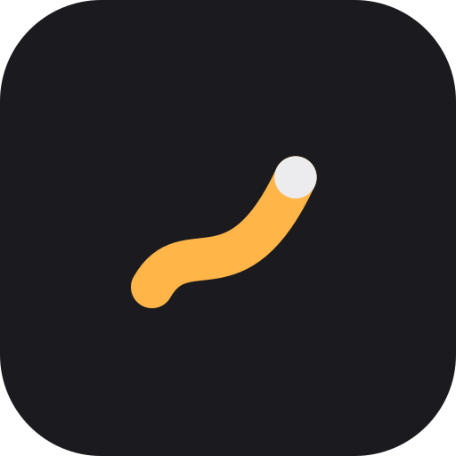
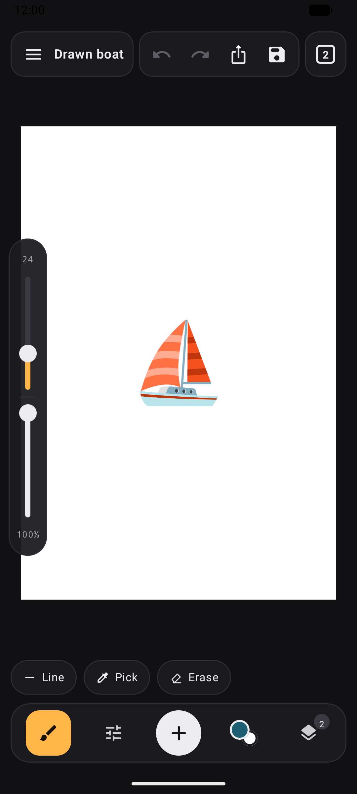
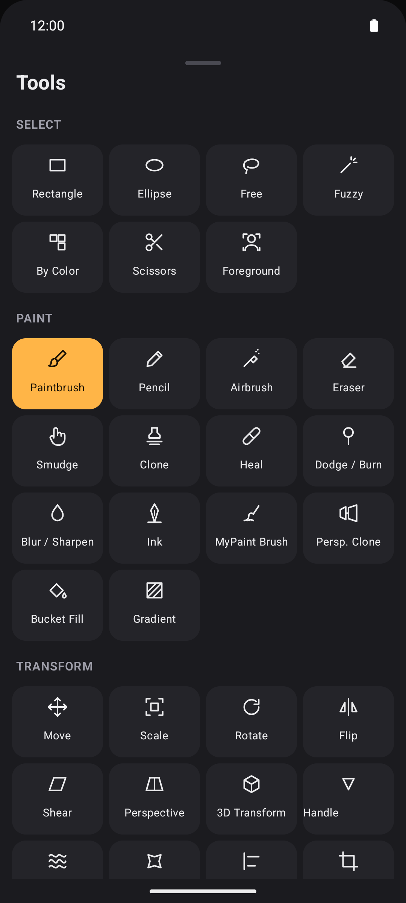
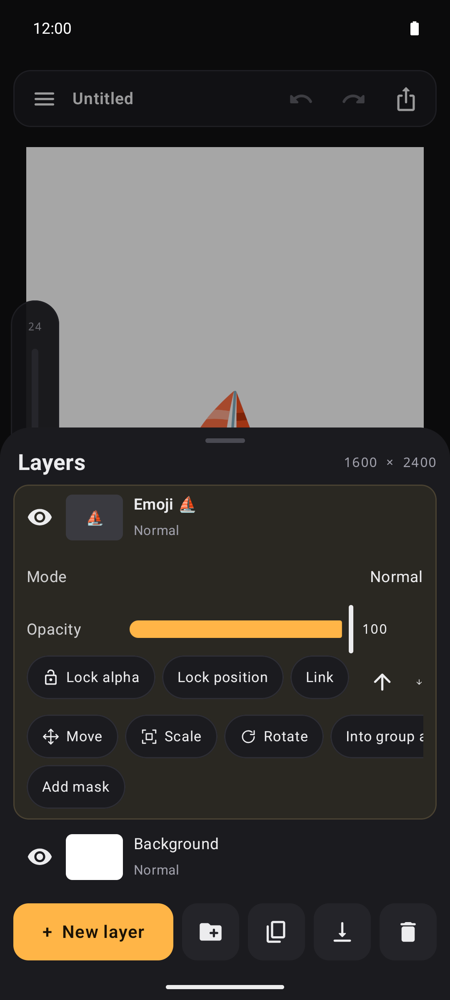
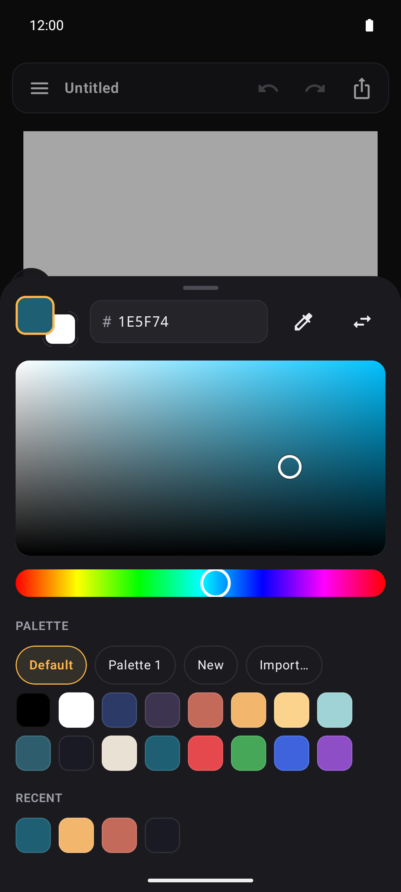
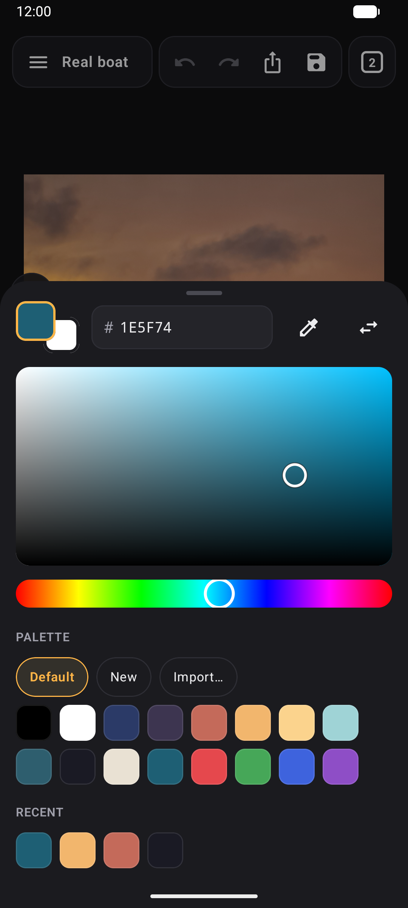
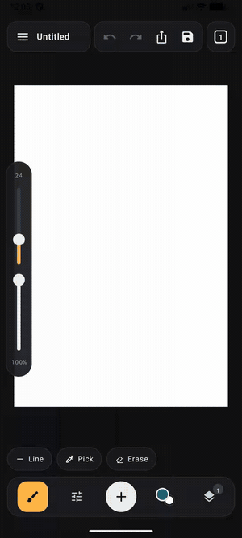
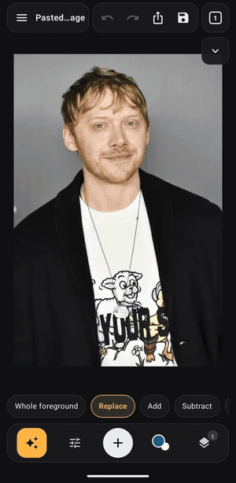

  

<strong>Brushkin</strong>

-----

A layered image editor for Android, inspired by GIMP and designed for fingers and styluses:

- Insert other images, vector graphics, emojis, stickers and text. 
- Paint, smudge, clone, heal, dodge/burn, ...
- Work on multiple images at once in tabs.
- Select with rectangle, lasso, fuzzy, Intelligent Scissors and quick mask, object select
- Transform with move, scale, rotate, perspective, warp, cage, ...
- Color adjustments: curves, levels, threshold, ...
- Filters: blur, depth blur, noise, edge detection, lighting, distortions and artistic effects.
- Work with layers, groups, blend modes, masks and editable text.
- Create and send custom stickers to WhatsApp or Telegram.
- Share images, save projects (xcf), and export PNG, JPEG, WebP or GIF

## Screenshots

  
  
  
  
  

## Demos

  
  

## Installation

Install it with [Komi Store](https://komistore.app) or download the APK from the [Releases page](https://github.com/nielstron/brushkin/releases).

## Filters and performance

Brushkin builds its filters from [gegl-opencl](https://github.com/nielstron/gegl-opencl),
a fork of GEGL (GIMPs graphic library) with fixed and new OpenCL kernels.

## License

GPL-3.0-or-later. Emoji names and keywords come from Unicode CLDR (Unicode License v3); the meme font is Anton (SIL Open Font License 1.1); the downloadable models are Apache-2.0 (MobileSAM) and MIT (the others).
