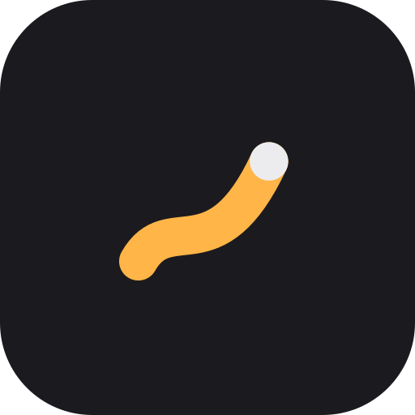
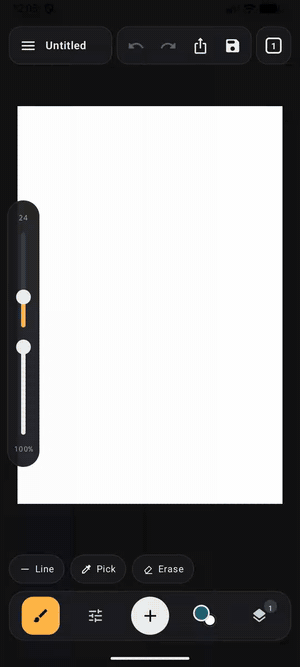
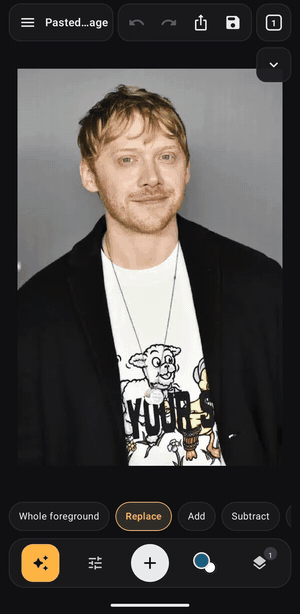
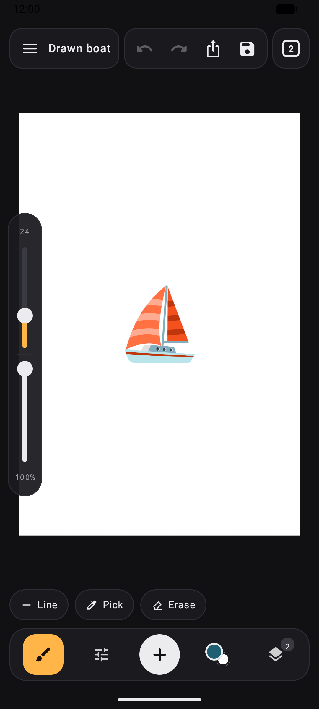
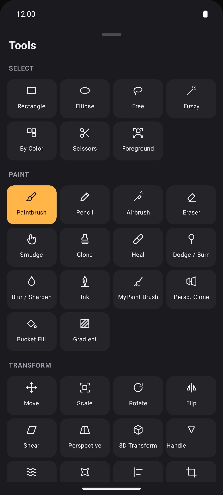
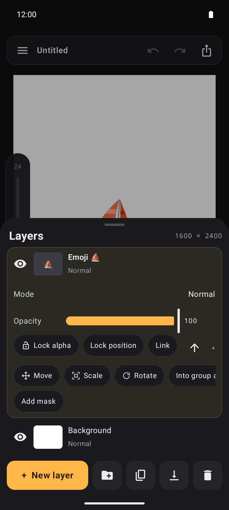
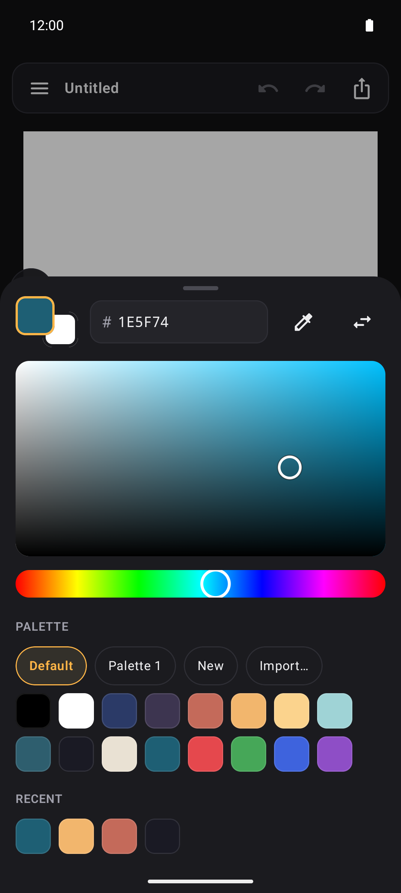
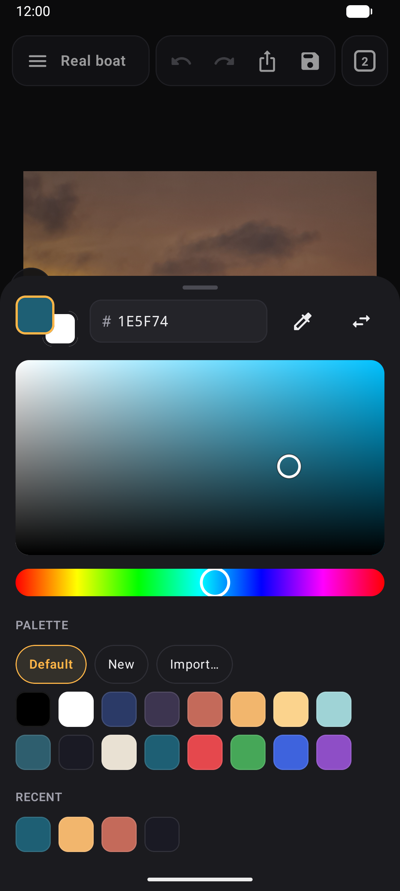

<div align="center">
  
</div>

<p align="center"><strong>Brushkin</strong></p>
<div align="center"><a href="https://komistore.app/app/?repo=nielstron/brushkin"></a></div>

-----

A layered image editor for Android, inspired by GIMP and designed for fingers and styluses:

- Insert other images, emojis, stickers and text.
- Paint with brushes, pencil, airbrush, ink and MyPaint-style brushes, plus smudge, clone, heal, dodge/burn and symmetry painting.
- Work on several images at once in tabs.
- Select with rectangle, lasso, fuzzy, Intelligent Scissors and quick mask.
- Lightweight AI tools: select objects, remove objects, background depth blur, upscale, denoise and deblur.
- Transform with move, scale, rotate, perspective, warp, cage and more, snapping to guides and a grid.
- Color adjustments and filters with live preview, including GIMP’s upstream GEGL operations: curves, levels, blur, noise, edge detection, lighting, distortions and artistic effects.
- Work with layers, groups, blend modes, masks and editable text; import GIMP brushes, gradients, palettes and patterns. Use **Effect** mode for editable, non-destructive filters.
- Share images, save projects as GIMP `.xcf` or OpenRaster `.ora`, and export PNG, JPEG, WebP or GIF, and send custom stickers to WhatsApp or Telegram.


## Screenshots

<div align="center">
  
  
</div>

<div align="center">
  
  
  
  
  
</div>

Sailing boat photo: [“Aruba — Catamaran Sailing at Sunset — 2023”](https://commons.wikimedia.org/wiki/File:Aruba_%E2%80%94_Catamaran_Sailing_at_Sunset_%E2%80%94_2023.jpg) by Rarends297, CC0.

## Installation

Requires Android 10 or newer and an ARM device (`arm64-v8a` or `armeabi-v7a`).

Install it with [Komi Store](https://komistore.app) (formerly GitHub Store), which also keeps it updated, or download the APK from the [Releases page](https://github.com/nielstron/brushkin/releases). F-Droid submission pending.

The AI tools use open models that aren't part of the APK. Each one is downloaded the first time its tool is used, after asking, and kept in the app's cache: [MobileSAM](https://github.com/ChaoningZhang/MobileSAM) (object selection), [MI-GAN](https://github.com/Picsart-AI-Research/MI-GAN) (object removal), [ZipDepth](https://github.com/fabiotosi92/ZipDepth) (depth of field), [PLKSR-Rep](https://github.com/Innocentlove321/ntire2026-mobile-realworld-sr-vipsl19) (upscaling) and [NAFNet](https://github.com/megvii-research/NAFNet) (denoise, deblur). The model files come from a [shared model release](https://github.com/nielstron/brushkin/releases/tag/models-2), are verified by size and SHA-256, and run locally through LiteRT, using the GPU where supported and the CPU otherwise.

## Filters and performance

Brushkin builds its filters from [gegl-opencl](https://github.com/nielstron/gegl-opencl),
a fork of GEGL master with fixed and new OpenCL kernels. On devices that expose an
OpenCL GPU driver to Android apps, these filters use GPU acceleration:

- Blurs: Gaussian (FIR and IIR, including one-dimensional), selective Gaussian, box,
  bilateral, linear/circular/zoom motion, median, mean curvature, lens, SNN mean,
  and Focus Blur in Gaussian mode.
- Distortions: whirl and pinch, polar coordinates, ripple, waves, lens distortion,
  and fractal trace.
- Noise: HSV, RGB, LCH, pick, slur, spread, noise reduction, DCT denoise, and
  simplex noise.
- Edges and artistic filters: Sobel, Laplace, edge detection, image gradient,
  domain transform, convolution matrix, emboss, normal map, newsprint, oilify,
  pixelize, cartoon, photocopy, soft glow, high pass, bloom, lens flare, supernova,
  deinterlace, video degradation, and Bevel with its default settings on images
  wider than one pixel.
- Colour: stretch contrast (RGB and HSV), colour enhance, brightness and contrast,
  levels, colour temperature, colour rotate, exposure, mono mixer, posterize,
  linear and perceptual invert, saturation, sepia, vignette, plus diffraction
  patterns and checkerboard.

The allowlist is based on CPU/GPU comparisons on a Pixel 6 Pro using opaque and
transparent inputs. Performance depends on the operation, settings, image size
and device. In the 6 MP GEGL benchmark on that phone, Gaussian Focus Blur took
about 1.5 s on OpenCL versus 4.5 s on the two-thread CPU. Lens Focus Blur uses
CPU rendering in the app after measuring about 2.7 s on OpenCL versus 2.2 s on
the CPU. Its OpenCL path is available in the survey. Unsupported devices and
operation settings use CPU rendering. LiteRT model acceleration is separate
from GEGL's OpenCL support.

Live effects stay editable and reuse cached stages and incremental updates where
supported, but can be expensive when drawing beneath them. Filter previews include existing effects, show computing progress, and allow pan and pinch
zoom while the dialog is open.

Brushkin is not a complete GIMP port. The editing pipeline stores 8-bit sRGB pixels
and clips filter output to layer bounds; selecting 16-bit PNG export does not add
editing precision. A GEGL graph editor and auxiliary-image inputs are not exposed.
Additional filter dialogs use GEGL’s numeric, boolean and enum metadata;
color/object parameters retain upstream defaults until dedicated controls are added.

## Build

Use JDK 21. Install Python 3.12+, pkg-config, Meson 1.12.1, and Ninja (for example,
`uv tool install meson==1.12.1` and `brew install pkg-config ninja` on macOS).
The Android SDK needs NDK 27.1.12297006 and CMake 3.22.1. The first native build
also downloads and compiles GEGL (the gegl-opencl fork), babl 0.1.128,
GLib 2.84.4, and json-glib 1.10.8 for both ARM architectures; subsequent builds
reuse the cache. `tools/build_gegl.py` pins the GEGL commit, source checksums, and
the libffi dependency revision. To build a local GEGL checkout instead, set
`BRUSHKIN_GEGL_SOURCE=<path>`; it builds that checkout's committed HEAD.
`BRUSHKIN_BUILD_JOBS` sets the native build's parallelism (default 6).

```sh
./gradlew :app:testDebugUnitTest :app:assembleDebug
```

Device tests (excluding the hardware-only survey):

```sh
./gradlew :app:connectedDebugAndroidTest \
  -Pandroid.testInstrumentationRunnerArguments.notClass=io.github.nielstron.brushkin.OpenClSurveyTest
```

To install a separate preview without replacing the normal app, build with `-PopenClPrototype=true`;
this changes only the debug app ID/version suffix, not which filters are accelerated.
`OpenClPrototypeTest` checks enabled GPU paths and CPU fallback;
`OpenClSurveyTest` benchmarks OpenCL candidates and requires an
OpenCL-capable device. Run the survey explicitly rather than as part of the default
suite on devices without OpenCL. `tools/export_mobilesam.py` and
`tools/export_models.py` reproduce the model files.

The default build stays ad-free and contains only free software. The Google Play distribution
includes a small banner below the title bar and a one-time ad-removal purchase (US$5 base price;
Google Play shows the local price). Build it explicitly with:

```sh
./gradlew -PplayStore=true :app:testDebugUnitTest :app:assembleDebug
./gradlew -PplayStore=true :app:bundleRelease
```

Debug Play builds use Google's test ads. Production AdMob IDs and the Play billing verification
public key are in `app/src/play/res/values/store.xml`. The non-consumable product ID is
`remove_ads`. The menu includes purchase restoration and, where required, ad privacy choices.
Signing still uses the `BRUSHKIN_KEYSTORE`, `BRUSHKIN_KEYSTORE_PASSWORD`, `BRUSHKIN_KEY_ALIAS`
and `BRUSHKIN_KEY_PASSWORD` environment variables. Keep private signing material outside the repository.

## License

GPL-3.0-or-later. Emoji names and keywords come from Unicode CLDR (Unicode License v3); the meme font is Anton (SIL Open Font License 1.1); the downloadable models are Apache-2.0 (MobileSAM) and MIT (the others).
